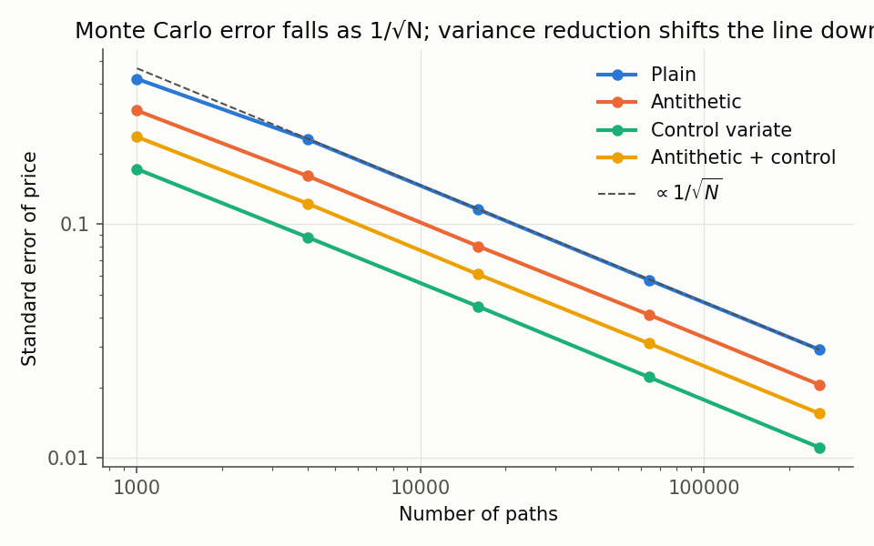
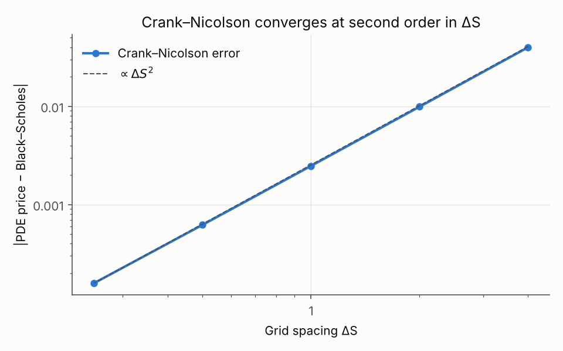
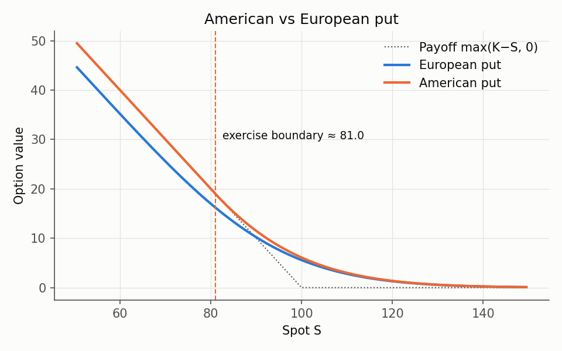
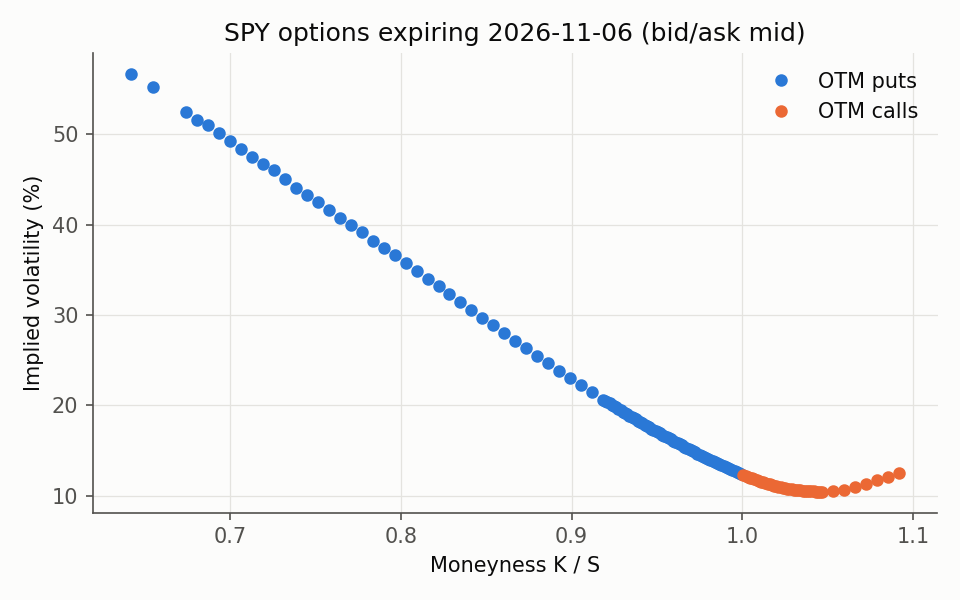
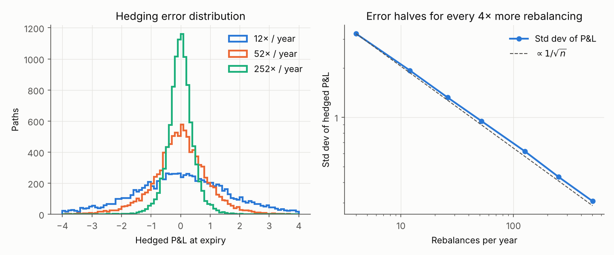

# derivlib: Derivatives Pricing & Hedging in Python

A compact, tested library that prices options three independent ways (closed form,
Monte Carlo, PDE), cross-checks them against each other, and uses them for
risk: Greeks, implied volatility and delta-hedging.

| Method | What it prices | Key technique |
|---|---|---|
| Black–Scholes closed form | European calls/puts, geometric Asians | analytic Greeks |
| Monte Carlo | European, arithmetic Asian | antithetic & control variates, pathwise Greeks |
| Crank–Nicolson PDE | European, **American** puts | Rannacher smoothing, Brennan–Schwartz early exercise |
| CRR binomial tree | European/American | independent check on the PDE |

Every number below is reproduced by `python examples/make_figures.py` (about 10 s).

## Quick start

```bash
pip install -e ".[dev,market]"
pytest                                   # 19 tests
python examples/make_figures.py          # regenerate figures/ and figures/results.md
python examples/make_figures.py --ticker SPY   # implied-vol smile from a live option chain
```

```python
from derivlib import bs_price, mc_asian_call, fd_price, implied_vol

bs_price(100, 100, 1.0, 0.05, 0.2, "call")                 # 10.4506
mc_asian_call(100, 100, 1.0, 0.05, 0.2, control_variate=True).price
fd_price(100, 100, 1.0, 0.05, 0.2, option="put", american=True).price   # 6.0895
implied_vol(10.4506, 100, 100, 1.0, 0.05, "call")         # 0.2000
```

## Results

### 1. Monte Carlo and variance reduction



European call, S = K = 100, T = 1, r = 5%, σ = 20% (Black–Scholes 10.4506), 256k paths:

| Method | Price | Std error | Variance reduction |
|---|---|---|---|
| Plain | 10.4526 | 0.0291 | 1.0× |
| Antithetic | 10.4376 | 0.0206 | 2.0× |
| Control variate (discounted S_T) | 10.4414 | 0.0111 | 6.9× |
| Antithetic + control | 10.4397 | 0.0155 | 3.5× |

**Variance reduction techniques do not simply stack.** After the control variate
removes the part of the payoff that is linear in S_T, what remains is mostly the
convex "kink" part, which is *symmetric* in Z. Antithetic pairs (Z, −Z) then
produce positively correlated residuals, so pairing them adds less information
than two independent draws.

**Arithmetic Asian call** (52 weekly fixings, 100k paths), using the closed-form
geometric Asian as control variate:

| Method | Price | Std error |
|---|---|---|
| Plain MC | 5.8441 | 0.0255 |
| Geometric-Asian control variate | 5.8529 | 0.00070 |

The control variate cuts the standard error **36×**, equivalent to running
about **1,300× more paths**. It works because arithmetic and geometric averages are
almost perfectly correlated, and the geometric one has an exact price.

### 2. Crank–Nicolson PDE solver



The error against Black–Scholes falls by 4× every time ΔS halves: second-order
convergence, as theory predicts (3.98e-2 at ΔS = 4 down to 1.59e-4 at ΔS = 0.25).



**American put** (S = K = 100): PDE 6.0895 vs CRR tree (5,000 steps) 6.0902;
European 5.5735, so the **early-exercise premium is 0.516**. Below the exercise
boundary (≈ 81) the option is worth exactly its intrinsic value and the holder
should exercise.

Implementation notes:
- **Rannacher smoothing**: the first steps are fully implicit half-steps. Pure
  Crank–Nicolson oscillates around the strike kink, which corrupts gamma.
- **Brennan–Schwartz**: the early-exercise constraint is applied inside the
  tridiagonal back-substitution. It is exact for puts and O(M) per step, so no
  iterative PSOR loop is needed.

### 3. Greeks three ways

| Greek | Analytic | Bump & revalue (BS) | Bump & revalue (MC, common random numbers) | Pathwise MC |
|---|---|---|---|---|
| Delta | 0.6368 | 0.6368 | 0.6346 | 0.6370 ± 0.0013 |
| Gamma | 0.0188 | 0.0188 | 0.0189 | n/a |
| Vega | 37.524 | 37.524 | 37.298 | 37.457 ± 0.169 |

- **Bump & revalue** works on any pricer, which is how risk systems handle exotics.
  On a Monte Carlo pricer it only works with a fixed seed (common random numbers);
  otherwise simulation noise swamps the bump.
- **Pathwise** differentiates the payoff along each path: unbiased and cheap, but it
  needs a continuous payoff. Gamma of a call (and anything for a digital) needs the
  likelihood-ratio method instead.

### 4. Implied volatility



Newton–Raphson using vega, with a Brent bracketing fallback when vega is tiny; prices that
violate no-arbitrage bounds are rejected. Fitted to a live SPY option chain (out-of-the-money
puts below spot, calls above, bid/ask mids), the smile shows the classic equity skew:
implied vol rises from about 9% just above spot to about 26% for strikes 6% below, the market
pricing crash risk that Black–Scholes' constant volatility ignores. On a synthetic chain with
known skew, recovered vols match the true ones to 1e-9.

### 5. Delta hedging



Sell a call at its Black–Scholes price and delta-hedge it under a real-world drift
of 10%:

| Rebalances / year | Mean P&L | Std dev P&L |
|---|---|---|
| 12 | −0.018 | 1.871 |
| 52 | −0.013 | 0.931 |
| 252 | +0.001 | 0.426 |

- The mean is ≈ 0 whatever the drift. That is the core idea of risk-neutral pricing:
  once hedged, the stock's expected return does not matter.
- The hedging error scales as 1/√n because the unhedged risk between rebalances is
  gamma × (ΔS)².
- `delta_hedge_pnl(..., hedge_sigma=0.25)` shows what happens when you hedge with
  the wrong volatility: the P&L acquires a non-zero mean.

## Layout

```
derivlib/
  black_scholes.py      closed-form prices, Greeks, geometric Asian
  monte_carlo.py        GBM paths, European/Asian MC, variance reduction, pathwise Greeks
  finite_difference.py  theta-scheme / Crank–Nicolson PDE, American puts, CRR tree
  greeks.py             model-agnostic bump-and-revalue
  implied_vol.py        Newton + Brent implied vol, smile from a chain
  hedging.py            discrete delta-hedging simulation
  market_data.py        option chains via yfinance
tests/                  19 tests: textbook values, parity, cross-method agreement
examples/make_figures.py
```

## Roadmap

- Heston stochastic volatility (MC with full truncation; semi-analytic pricing via characteristic function)
- Barrier options (PDE with absorbing boundary; MC with Brownian-bridge correction)
- Interest-rate swap exposure profiles (EE / PFE) under Hull–White, as a first step to CVA
- Sobol quasi-random numbers for MC
